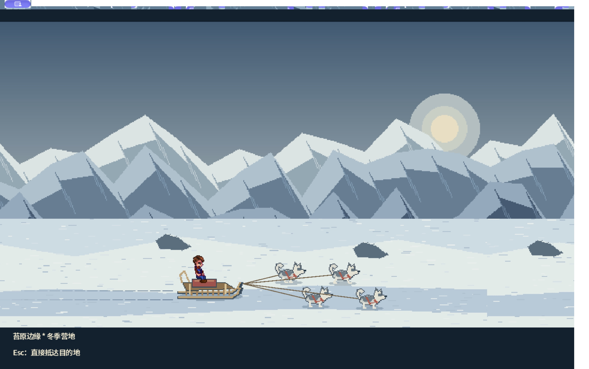
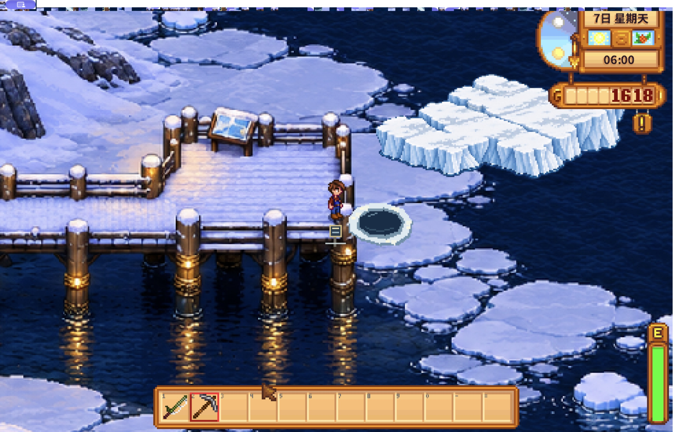

# 霜灯港 / Frosthavn

《星露谷物语》电脑端的北极渔港扩展：月月鸟航空、雪跑道、彩色木屋、岩岸峡湾、苔原、冬季冰钓和犬队交通。

**当前发布：0.7.10，面向电脑端单人游玩。** 已实测macOS、游戏1.6.15、SMAPI4.5.2、Content Patcher2.9.1；其他电脑系统尚未完成实机验证。

[GitHub 0.7.10 安装包](https://github.com/MiniLaba/ArcticPassage/releases/tag/v0.7.10) · [中文安装指南](INSTALL.zh-CN.md) · [当前内容与限制](docs/PLAYER_STATUS.md) · [更新记录](CHANGELOG.md) · [Windows兼容范围](docs/WINDOWS_COMPATIBILITY.md)

## 安装

1. 安装[SMAPI](https://smapi.io/)和[Content Patcher](https://www.nexusmods.com/stardewvalley/mods/1915)。
2. 从发布页下载`ArcticPassage-0.7.10-install.zip`。
3. 解压，将`ArcticPassage`、`ArcticPassage.Runtime`两个文件夹一起放入游戏的`Mods`目录。
4. 通过SMAPI启动游戏，查看月月鸟邀请信；到巴士站按B、Enter出发。没有收到信时先正常过夜。

正确层级：

```text
Mods/
├── ContentPatcher/manifest.json
├── ArcticPassage/manifest.json
└── ArcticPassage.Runtime/manifest.json
```

玩家请下载**install.zip**；源码包需要开发环境，不能直接安装。详细系统路径、初访、更新、备份和排错见[完整安装指南](INSTALL.zh-CN.md)。

## 已接入内容

- 诺拉、莱文、阿玛采用全新代码绘制肖像与六种表情，官网与游戏使用相同造型；手记在小窗口下支持滚轮选择。
- 月月鸟邀请与机票、24秒北极飞行和雪跑道降落、免费返乡。
- 八处室外与四主要室内，四季地图；镇区、渔港、峡湾、苔原、营地、机场、山路、冰川；六位居民的住所、季节日程、对白和友情事件资料。
- 九种海产、四料理、原生钓鱼/蟹笼、熏鱼机兼容、两夜风干加工。
- 六步基础交货与建设、日单、两种基础周委托及通关后出口订单；既有修船、峡湾奖励往返和竹竿购买已在普通角色保存冷载。
- 日单区分普通交货、银星以上餐馆鲜鱼（米拉友谊+25）与首次交样登记；交货说明显示具体货款。餐馆品质扣料／防重奖等已通过隔离原生检查，普通三类日单完整游玩保存仍待。
- 冬季固定冰洞、四步犬队解锁、苔原/营地/冰川三站演出交通。
- 随身手记、动物与科研账目、极昼极夜／极光／风雪规则、七项秘密和三场年度节日已有代码首版。
- 原六步任务后已连接社区补给／实钓／米拉安全对话、雪块与冰洞、跨水域加工出口，以及六居民冬夜灯火结尾；实际游戏日期保留。
- 分区风潮与三首配乐初稿；音轨循环听感、全季全区美术统一仍待完成。

**实现不等于完整验收。** 新增居民事件、动物科研、天气画面、节日和隐藏线索虽已接入代码，十章主线后半段也已接入候选实现，但这些新内容尚未在普通存档中通关。普通深水钓获、剩余鱼虾／料理订单、完整冬季流程、全季美术与声音、多人及旧档升级仍待。具体边界见[玩家状态说明](docs/PLAYER_STATUS.md)。





以上为隔离测试角色的真实游戏截图，尚不代表普通角色完整流程已通过。

## 开发与许可

本仓库提供内容包、运行模块、生成程序及原始素材。[源码构建说明](docs/BUILDING.md)面向开发者；玩家安装无需编译。

原创代码与项目素材使用[MIT许可](LICENSE)。资源来源、历史生成素材和第三方音色许可见[CREDITS](CREDITS.md)及[音色许可](docs/licenses/GeneralUser-GS.txt)。
